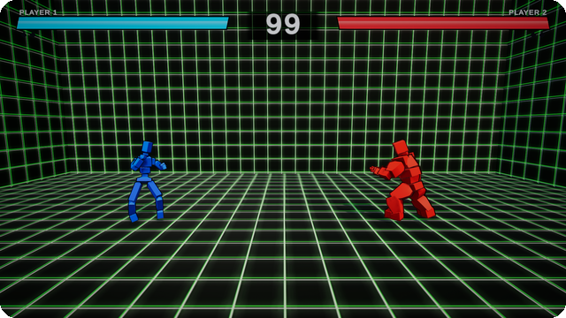
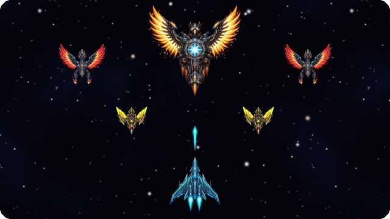
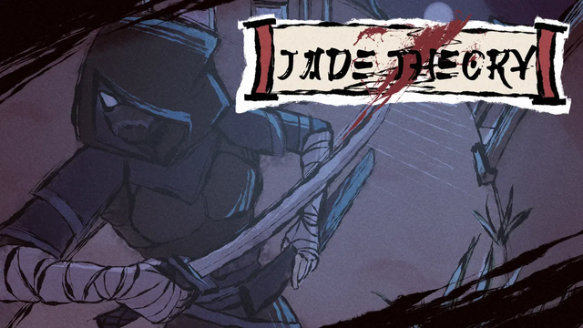
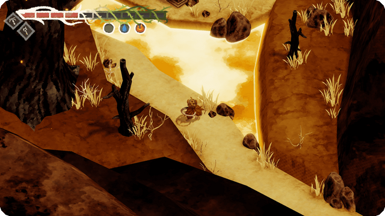
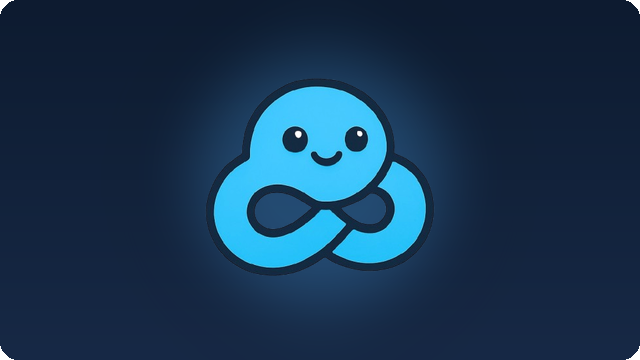

# Víctor Cárdenas

### Game developer · Unity / C# · C++

Barcelona &nbsp;·&nbsp; 4th year of Video Game Design and Development at CITM (UPC)

&nbsp;&nbsp;&nbsp;

 

## About me

I'm a game developer from Barcelona. I mostly work in Unity and C#, and I enjoy gameplay and combat: responsive controls, hits that read clearly and the feedback that makes them land.

- **On my own** I shipped an Android game and wrote the combat core of a 2.5D fighting game.
- **In teams** I was lead programmer in a team of 5, and I worked on two C++ engines and on a game made with one of them.
- **Audio** is my second strong point: I integrated FMOD into a C++ engine and did the audio of a Unity walking simulator.

> **I'm looking for an internship at a game studio, in any role** (university agreement, starting before February 2027). Barcelona, or anywhere I can relocate to.

 

## Selected work

<table>
  <tr>
    <td width="50%" valign="top">
      
      <h3>Counterhit</h3>
      
The combat core of a 2.5D fighting game: state machine, frame data, an input buffer that reads motion inputs, combos, juggles and hitstop.

      
<code>Unity 6</code> <code>C#</code> <code>Solo</code>

      <a href="https://github.com/Vixtorbir/Counterhit"><b>View code →</b></a>
    </td>
    <td width="50%" valign="top">
      
      <h3>Ave Phoenix Regen</h3>
      
A remake of the arcade game my father played as a kid, made as a birthday present for him. Story and arcade modes, a boss state machine and object pooling, released as an APK.

      
<code>Unity 6</code> <code>C#</code> <code>Android</code> <code>Solo</code>

      <a href="https://github.com/Vixtorbir/Ave-Phoenix-Regen/releases/latest"><b>Download the APK →</b></a>
    </td>
  </tr>
  <tr>
    <td width="50%" valign="top">
      
      <h3>Jade Theory</h3>
      
A narrative 2D metroidvania set in feudal Japan. I was lead programmer: player controls, the ninja enemy AI, a multi-phase boss and Tiled maps.

      
<code>C++</code> <code>SDL</code> <code>Team of 5</code>

      <a href="https://github.com/Vixtorbir/Ninja-CamareroUnaRubia/releases"><b>Builds →</b></a> &nbsp; <a href="https://github.com/Vixtorbir/Ninja-CamareroUnaRubia"><b>Code →</b></a>
    </td>
    <td width="50%" valign="top">
      
      <h3>The Fable of the Eclipse</h3>
      
A 3D action game made in our own engine and released on itch.io. I made the HUD, items and healing, popups, puzzles and the God Mode debug tools.

      
<code>C#</code> <code>LoopieEngine</code> <code>Team project</code>

      <a href="https://mini-knight-studio.itch.io/fable-of-the-eclipse"><b>Play on itch.io →</b></a>
    </td>
  </tr>
  <tr>
    <td width="50%" valign="top">
      
      <h3>LoopieEngine</h3>
      
A Unity-style C++ engine with an editor and C# scripting. I integrated FMOD: an AudioManager, AudioSource and AudioListener components and their inspector panels.

      
<code>C++</code> <code>FMOD</code> <code>Team project</code>

      <a href="https://github.com/Mini-Knight-Studio/LoopieEngine/commits?author=Vixtorbir"><b>See my commits →</b></a>
    </td>
    <td width="50%" valign="top">
      <h3>More projects</h3>
      
<a href="https://github.com/UPC-GameEngines-BCN-2025/GameJamEngine"><b>GameJamEngine</b></a>: C++ and OpenGL engine, team of 3. GameObject and Inspector system, resource manager, scene save and load, octree and mouse picking.

      
<a href="https://github.com/Vixtorbir/Xarxes-Juego"><b>Multiplayer arena</b></a>: Unity over UDP, team of 4. Lobby, chat and a binary serializer.

      
<a href="https://github.com/Vixtorbir/Practica-de-Audio-Unity"><b>Audio walking simulator</b></a>: Unity, team of 2. Mixer routing, snapshots and 3D sound.

      
<a href="https://github.com/Vixtorbir/GameAnalytics-Delivery1"><b>Game Analytics</b></a>: team of 3. Unity player simulator, PHP server and SQL KPI queries.

      
<a href="https://github.com/Vixtorbir/Racing-Pony"><b>Racing Pony</b></a>: C++, team of 4. Menus, lap counting, nitro and a first AI driver.

      <a href="https://vixtorbir.github.io/"><b>All projects on my portfolio →</b></a>
    </td>
  </tr>
</table>

 

## Tools

  
  
  
  
  
  

## Languages

Spanish (native) &nbsp;·&nbsp; Catalan (native) &nbsp;·&nbsp; English (B2, Cambridge First Certificate)
