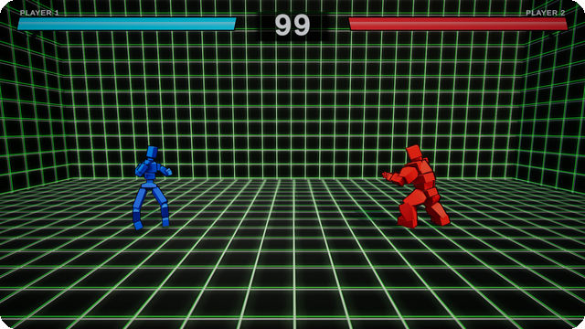
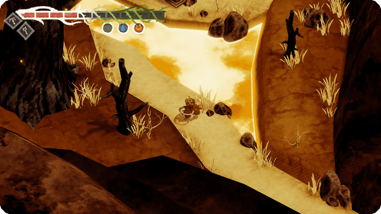
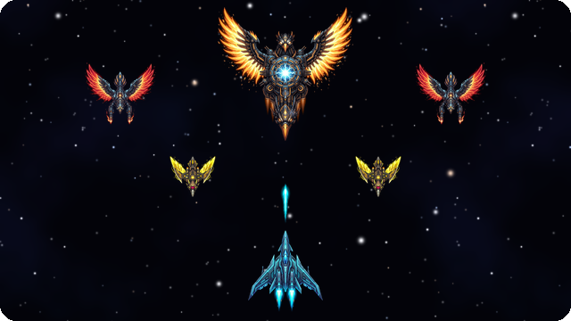

# Víctor Cárdenas

### Gameplay Programmer · Unity / C# · C++

Barcelona &nbsp;·&nbsp; CITM – Universitat Politècnica de Catalunya

&nbsp;

 

## About me

I'm a final-year **Game Design & Development** student who loves the part of a game you feel in your hands.

**What I enjoy most:** responsive controls, combat that reads clearly, and the feedback (hitstop, camera, sound) that makes every action land.

**My second passion:** audio, connecting gameplay and sound so they work as one system.

**How I work:** I was lead programmer on a five-person team, helped build our own C++ engine and shipped a game on it. On my own, I like taking a game from the first prototype to something people can download and play.

> **Currently looking for a gameplay programming internship** (university agreement), in Barcelona or anywhere I can relocate to.

 

## Selected work

<table>
  <tr>
    <td width="50%" valign="top">
      
      <h3>2.5D Fighting Game</h3>
      
The combat core of a Street Fighter style fighter: state machine, input buffer, combos and hitstop.

      
<code>Unity</code> <code>C#</code> <code>Solo</code>

      <a href="https://github.com/Vixtorbir/Juego-de-Peleas-BH6"><b>View repository →</b></a>
    </td>
    <td width="50%" valign="top">
      
      <h3>LoopieEngine</h3>
      
Our in-house game engine. I integrated FMOD and built the base of its audio subsystem.

      
<code>C++</code> <code>FMOD</code> <code>Team</code>

      <a href="https://github.com/Mini-Knight-Studio/LoopieEngine/commits?author=Vixtorbir"><b>See my commits →</b></a>
    </td>
  </tr>
  <tr>
    <td width="50%" valign="top">
      
      <h3>The Fable of the Eclipse</h3>
      
A 3D action game made with our own engine. I worked on the HUD and the items.

      
<code>C#</code> <code>LoopieEngine</code> <code>Team</code>

      <a href="https://mini-knight-studio.itch.io/fable-of-the-eclipse"><b>Play on itch.io →</b></a>
    </td>
    <td width="50%" valign="top">
      
      <h3>Ave Phoenix Regen</h3>
      
A remake of the arcade game my father played as a kid, made as a birthday present for him.

      
<code>Unity</code> <code>Android</code> <code>Solo</code>

      <a href="https://github.com/Vixtorbir/Ave-Phoenix-Regen/releases/latest"><b>Download the APK →</b></a>
    </td>
  </tr>
</table>

 

## Tools

  
  
  
  
  
  

## Languages

Spanish (native) &nbsp;·&nbsp; Catalan (native) &nbsp;·&nbsp; English (B2, Cambridge First Certificate)
